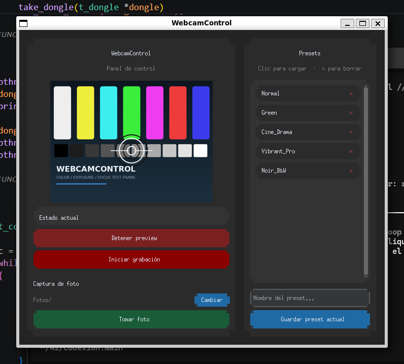
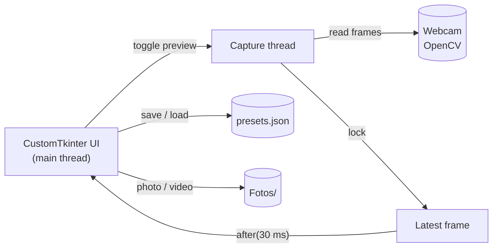

<p align="center">
  
</p>

<h1 align="center">WebcamControl</h1>

<p align="center">
  <strong>A desktop control panel for your webcam.</strong><br>
  Tune the image live, save 19-property presets, and capture photos or video.
</p>

<p align="center">
  <a href="https://github.com/VicProgram/WebcamControl/actions/workflows/ci.yml"></a>
  
  
  
</p>

---

**WebcamControl** is a small Python desktop application that puts the webcam
properties buried in your camera driver behind a clean, dark UI. It shows a
live preview, lets you adjust the five settings that matter most, stores the
full configuration as reusable JSON presets, and writes photos and MP4 videos
to the folder you choose.

The screenshot above is the real application running with a synthetic test
frame, so it can be reproduced without a physical webcam.

## Why this exists

Most webcams expose brightness, contrast, saturation, exposure, gain, focus,
white balance and a dozen more properties through OpenCV, but no usable
interface to change them. OBS is overkill for a quick call, and the vendor
utilities are Windows-only or bundled with bloatware. This project is the
missing control panel: one window, live feedback, presets that survive a
reboot.

## Features

- **Live preview** — frames are captured on a background thread, so the UI
  never freezes.
- **Five quick controls** — brightness, contrast, saturation, exposure and
  gain, with live values and automatic clamping to each camera's range.
- **19-property presets** — save the whole camera state to `presets.json`,
  reload it with one click, delete what you no longer need.
- **Native advanced panel** — on Windows, opens the DirectShow properties
  dialog for the settings the UI does not expose.
- **Photo capture** — saves a timestamped JPEG from the current frame (or a
  fresh one if the preview is off).
- **Video recording** — MP4 at 20 FPS, with a red REC indicator in the
  preview.
- **Custom output folder** — photos and videos can live anywhere.
- **Dark, responsive UI** — built with CustomTkinter; resizable and
  high-DPI friendly.

## Tech stack

| Layer | Technology |
|---|---|
| Language | Python 3.10+ |
| Camera I/O | OpenCV (`cv2.VideoCapture`, `VideoWriter`) |
| UI | CustomTkinter + Tkinter |
| Images | Pillow |
| Quality | pytest, pytest-mock, pytest-cov, ruff |
| CI | GitHub Actions (Python 3.10 and 3.12) |

## Quick start

```bash
git clone https://github.com/VicProgram/WebcamControl.git
cd WebcamControl
make install
make run
```

Or without Make:

```bash
python -m venv .venv
source .venv/bin/activate        # Windows: .venv\Scripts\activate
pip install -e ".[dev]"
python webcam_control.py
```

> **Camera permission:** on Windows, allow desktop apps to access the camera
> (Settings → Privacy → Camera). On macOS, grant camera access to Terminal or
> your IDE the first time you run the app.

## Usage

1. **Preview** — press *Iniciar preview*. The capture thread starts and the
   frame appears in the left panel.
2. **Tune** — move the sliders. Each change is applied to the camera
   immediately and reflected in the preview.
3. **Save a preset** — type a name and press *Guardar preset actual*. All 19
   properties are stored; values the camera does not support are saved as
   `-1` and skipped when loading.
4. **Capture** — *Tomar foto* saves a JPEG. *Iniciar grabación* records an MP4
   (preview must be active).
5. **Choose a folder** — *Cambiar* next to the output path.

Everything is written to `Fotos/` by default, next to `webcam_control.py`.

## How it works



The UI and the capture loop never touch the same frame at the same time: the
worker writes under a `threading.Lock`, and the main thread copies it under the
same lock before converting it to a `CTkImage`. Display updates are scheduled
with Tk's `after()`, which keeps all widget calls on the main thread.

## Presets format

`presets.json` is a plain object: preset name → camera property → value.

```json
{
    "Normal": {
        "Brillo": 0.0,
        "Contraste": 15.0,
        "Saturación": 10.0,
        "Exposicion": -4.0,
        "Ganancia": 32.0,
        "Foco": -1.0,
        "Zoom": -1.0
    }
}
```

The file ships with a `Normal` preset as an example. A value of `-1` means
"not supported by this camera" and is skipped on load.

## Tests and quality

```bash
make lint       # ruff check + format check
make test       # 71 tests, no webcam required
make coverage   # coverage report
make ci         # what GitHub Actions runs
```

The suite mocks Tkinter, CustomTkinter and OpenCV, so it runs headless in CI.
It covers preset persistence, error paths, preview threading, recording, photo
capture and window shutdown. Current line coverage: **95%**.

## Project structure

```
.
├── webcam_control.py        # application (UI + camera logic)
├── presets.json             # example preset database
├── tests/
│   ├── conftest.py          # Tk/OpenCV mocks and fixtures
│   ├── test_app.py          # UI, preview, recording, photo capture
│   └── test_presets.py      # preset load/save/delete
├── docs/
│   ├── screenshot.png
│   ├── GUIA_TECNICA.es.md   # detailed Spanish technical guide
│   └── ROADMAP.es.md        # ideas and pending improvements
├── .github/workflows/ci.yml
├── Makefile
├── pyproject.toml
└── LICENSE
```

## Compatibility

| Platform | Preview / presets / capture | Native advanced panel |
|---|---|---|
| Windows 10/11 | Yes (DirectShow) | Yes |
| Linux | Yes (V4L2) | No |
| macOS | Yes (AVFoundation) | No |

Some cameras expose only a subset of the 19 properties. The app reads each
value first and marks unsupported ones as `No soportado` instead of sending an
invalid setting.

## Roadmap

See [`docs/ROADMAP.es.md`](docs/ROADMAP.es.md) for the full list. Highlights:
reuse the `CTkImage` between frames, add a camera selector, fix the preview
aspect ratio, and add keyboard shortcuts.

## License

MIT © 2026 Victor Abad Romero. See [`LICENSE`](LICENSE).

---

<sub>Documentación técnica detallada en español: [`docs/GUIA_TECNICA.es.md`](docs/GUIA_TECNICA.es.md).</sub>
